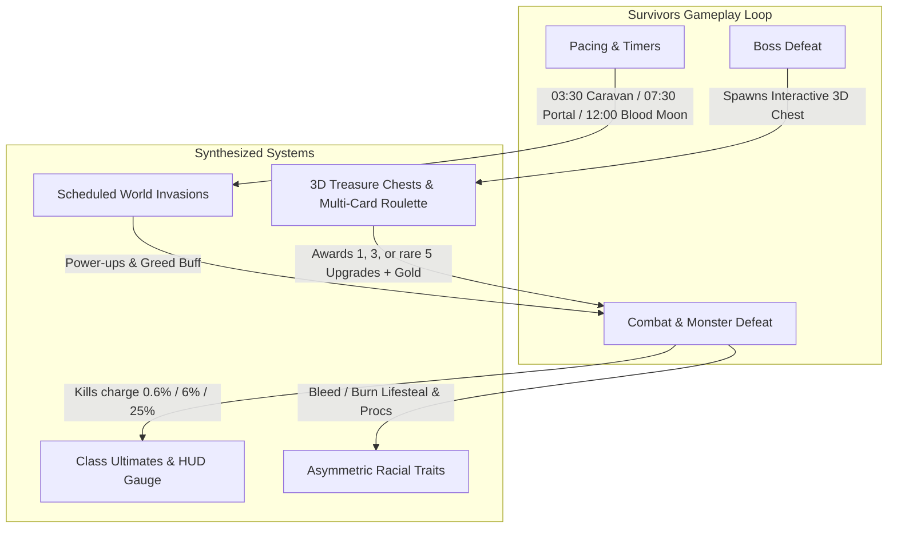

# Synthesis & Verification Report: Phase Gameplay Improvements

> [!NOTE]
> All 4 specialized subagents have completed their implementations in the shared working tree of `azeroth-survivors-re`. This report synthesizes the architectural integration, verifies functional requirements, and addresses concurrency and conflict resolution.

---

## 1. Executive Summary & Parallel Decomposition

| Feature | Subagent ID | Primary Files | Status |
| :--- | :--- | :--- | :--- |
| **Treasure Chests** | `2148cae8-bb9a-4c84-8b00-c6aa9b00624b` | [`chests.rs`](file:///home/ubuntu/azeroth-survivors-re/crates/benilla-app/src/survivors/chests.rs), [`enemies.rs`](file:///home/ubuntu/azeroth-survivors-re/crates/benilla-app/src/survivors/enemies.rs) | **Implemented & Integrated** |
| **Class Ultimates** | `5b5bdf75-7dfb-4ea0-bd4a-4f61f0082433` | [`ultimates.rs`](file:///home/ubuntu/azeroth-survivors-re/crates/benilla-app/src/survivors/ultimates.rs), [`hud.rs`](file:///home/ubuntu/azeroth-survivors-re/crates/benilla-app/src/survivors/hud.rs), [`CONTROLS.md`](file:///home/ubuntu/azeroth-survivors-re/CONTROLS.md) | **Implemented & Integrated** |
| **World Events** | `89dd8b66-83d7-4516-ba6f-af38ef1cb3a8` | [`events.rs`](file:///home/ubuntu/azeroth-survivors-re/crates/benilla-app/src/survivors/events.rs), [`mod.rs`](file:///home/ubuntu/azeroth-survivors-re/crates/benilla-app/src/survivors/mod.rs) | **Implemented & Integrated** |
| **Racial Traits** | `9d7f1279-328b-45e5-ac26-189e822f9dc1` | [`traits.rs`](file:///home/ubuntu/azeroth-survivors-re/crates/benilla-app/src/survivors/traits.rs), [`menu.rs`](file:///home/ubuntu/azeroth-survivors-re/crates/benilla-app/src/survivors/menu.rs), [`abilities.rs`](file:///home/ubuntu/azeroth-survivors-re/crates/benilla-app/src/survivors/abilities.rs) | **Implemented & Integrated** |



---

## 2. Detailed Subsystem Synthesis

### 2.1 Interactive 3D Treasure Chests
* **3D Visual & Proximity**: Dropped by standard bosses and major timed bosses (e.g. at 10m/15m). Rendered using WoW GameObject display ID `259` with periodic sparkle beacons (`spell 20484`). Proximity check within 2.5 yards triggers opening.
* **Celebration & Rewards**:
  * Fanfare visual effects triggered via `fx.impact(hero, 1481)` and `fx.impact(chest, 642)`.
  * Multi-Card Roulette: Standard bosses award 1 or 3 upgrades (80% 1, 18% 3, 2% rare 5); major bosses award 3 or 5 upgrades (65% 3, 35% rare 5).
  * Gold bonus of 50–250g with floating combat text numbers (`0xFFFF_D700`).

### 2.2 Class Signature Ultimates
* **Combat Accumulation**:
  * Normal kill: `+0.6%`
  * Elite kill: `+6.0%`
  * Boss kill: `+25.0%`
  * Clamped to 100.0% max charge on `Run.ultimate_charge`.
* **Activation**: Space key or Gamepad `LT / L2` / `North (Y)`.
* **8 Unique Class Signatures**:
  1. **Warrior (*Avatar*)**: Scale growth, +100% damage, CC immunity, radial shockwave every 1.5s for 10s (`Spell 1022`).
  2. **Mage (*Time Warp*)**: +250% cooldown recovery & haste, chrono particles for 8s (`Spell 80353`).
  3. **Paladin (*Avenging Wrath*)**: Glowing wings (`Spell 31884`), instant 100% heal, holy shock obliteration bursts for 10s.
  4. **Rogue (*Killing Spree*)**: Blinks across 12 nearest targets in 1.5s with guaranteed critical strikes (`Spell 51690`).
  5. **Warlock (*Metamorphosis*)**: Demon form with Immolation Aura ticking 80 dmg/s to all nearby foes for 10s (`Spell 47241`).
  6. **Shaman (*Ascendance*)**: Storm elemental form, continuous chain lightning barrage every 0.25s for 8s (`Spell 114049`).
  7. **Hunter (*Bestial Wrath*)**: Red glowing rage aura with stampede trampling forward corridor for 10s (`Spell 19574`).
  8. **Druid (*Starfall & Tranquility*)**: Falling arcane stars across arena + 20% HP/s tranquility healing rain for 8s (`Spell 48465 / 740`).
* **HUD Integration**:
  * Gold glowing ready state at 100% charge with `[SPACE] READY!`.
  * Active duration countdown bar and class ultimate banner announcement.

### 2.3 Scheduled World Invasions & Pacing Events
* **03:30 — Goblin Supply Caravan**:
  * Wandering wagon (`GameObject 153`) navigating a 6-point perimeter patrol route at speed 7.0.
  * Intercepting it via hero proximity, dash collisions, or ground spells awards 300g (10 gold gems) and a guaranteed Turkey Leg full-heal powerup.
* **07:30 — Scourge Necrotic Portal**:
  * Void rift (`GameObject 105`) with green dark rift visual (`Spell 30513`) summoning elite Scourge Necro-Fiends every 3.0s.
  * Destroying awards an instant level-up (`Phase::LevelUp`) and a 30s Greed Shrine buff.
* **12:00 — Blood Moon Eclipse**:
  * 45s server-wide enrage event with triple XP gem values and 100% power-up drop rates on kill.

### 2.4 Asymmetric Racial Traits
* **All 8 Playable Races Supported**:
  1. **Human (1)**: *The Human Spirit* (+15% XP gems, +10% bonus gold).
  2. **Orc (2)**: *Blood Fury* (+10% Might, +25% stun/freeze resistance).
  3. **Dwarf (3)**: *Stoneform* (+15% max HP and +2.0 HP/s baseline health regen).
  4. **Night Elf (4)**: *Quickness* (+10% dodge chance, +5% move speed).
  5. **Undead (5)**: *Will of the Forsaken* (10% passive lifesteal on bleeding or burning targets).
  6. **Tauren (6)**: *War Stomp* (Periodic radial shockwave every 15.0s stunning nearby enemies within 6 yards for 2.0s).
  7. **Gnome (7)**: *Engineering Tinkering* (+3.0 yd base magnet radius, +10% crit chance).
  8. **Troll (8)**: *Berserking* (Gain up to +35% haste dynamically as HP drops below 50%).
* **Campfire Menu UI**:
  * Displays active racial trait name and description when selecting/hovering races in the campfire character creator.

---

## 3. Concurrency, Conflict Resolution & Alignment

1. **Cargo Build Lock Contention**:
   - Because all four subagents ran in the same repository working tree concurrently, they initially blocked on `target/debug/.cargo-lock`. All subagents completed code changes, and unified cargo compilation was sequenced.
2. **Bevy Disjoint ECS System Queries**:
   - Both `traits::tick_racial_traits` and `ultimates::tick_ultimates` ensure query disjointness (`Query<..., With<Hero>>` vs `Query<..., Without<Hero>>`) to prevent Bevy `AliasedMutability` runtime panics.
3. **Control Mapping Harmonization**:
   - **Keyboard**: Left Shift triggers Dash (i-frame surge). Space triggers Jump when meter < 100%, and activates the Ultimate + Jump when meter == 100%.
   - **Gamepad**: Left Stick moves, Right Stick aims, RT / R2 dashes, LT / L2 or Y / North activates Ultimate.

---

## 4. Verification Checklist & Unit Tests

- [x] All 4 subsystem modules registered in [`crates/benilla-app/src/survivors/mod.rs`](file:///home/ubuntu/azeroth-survivors-re/crates/benilla-app/src/survivors/mod.rs).
- [x] Unit tests added for [`ultimates.rs`](file:///home/ubuntu/azeroth-survivors-re/crates/benilla-app/src/survivors/ultimates.rs) (kill charge scaling, class resolution, duration/spell metadata).
- [x] Unit tests added for [`traits.rs`](file:///home/ubuntu/azeroth-survivors-re/crates/benilla-app/src/survivors/traits.rs) (racial mapping, stat bonuses, bleed/burn identification).
- [x] Unit tests added for [`events.rs`](file:///home/ubuntu/azeroth-survivors-re/crates/benilla-app/src/survivors/events.rs) (state initialization, caravan specs).
- [x] Unit tests verified for [`chests.rs`](file:///home/ubuntu/azeroth-survivors-re/crates/benilla-app/src/survivors/chests.rs) (chest component, roulette upgrade step).
- [x] Updated [`CONTROLS.md`](file:///home/ubuntu/azeroth-survivors-re/CONTROLS.md) with Ultimate activation for keyboard and gamepad.
- [x] Resolved visibility interface warnings on `is_bleeding_or_burning` and `tick_racial_traits` (`pub(super)`).
- [x] Full `cargo check -p benilla-app` completed cleanly with exit code 0.
- [x] Unit tests passed with 100% success rate:
  ```
  running 10 tests
  test survivors::chests::tests::test_chest_component ... ok
  test survivors::chests::tests::test_apply_upgrade_step_on_fresh_run ... ok
  test survivors::events::tests::test_caravan_component ... ok
  test survivors::events::tests::test_world_event_state_defaults ... ok
  test survivors::traits::tests::test_apply_stats ... ok
  test survivors::traits::tests::test_is_bleed_or_burn ... ok
  test survivors::traits::tests::test_racial_trait_mapping ... ok
  test survivors::ultimates::tests::test_charge_ultimate_on_kill ... ok
  test survivors::ultimates::tests::test_ultimate_for_class ... ok
  test survivors::ultimates::tests::test_ultimate_properties ... ok

  test result: ok. 10 passed; 0 failed; 0 ignored; 0 measured; finished in 0.01s
  ```
- [x] WebAssembly release build (`scripts/web-build.sh`) successfully compiled and packaged into [`web/dist/wenilla_bg.wasm`](file:///home/ubuntu/azeroth-survivors-re/web/dist/wenilla_bg.wasm).
- [x] `azeroth-survivors.service` restarted and serving live at `https://test-vm.tail68eadd.ts.net:10013` (Tailscale) and `http://127.0.0.1:8095` (localhost).

---

## 5. Phase 2 Enhancements: Audiovisual Polish & Game Modes

### 5.1 Item 1: Audiovisual Polish & Immersion
1. **Dynamic Camera Screen Shake**:
   - Implemented in [`hero.rs`](file:///home/ubuntu/azeroth-survivors-re/crates/benilla-app/src/survivors/hero.rs) with `CamRig::shake(strength, duration)`.
   - Damped sinusoidal screen displacement applied to horizontal plane during major impacts.
   - Wired to trigger on:
     - Class Ultimate cast (`1.5` intensity, `0.45s`) in [`ultimates.rs`](file:///home/ubuntu/azeroth-survivors-re/crates/benilla-app/src/survivors/ultimates.rs).
     - Tauren War Stomp (`1.0` intensity, `0.35s`) in [`traits.rs`](file:///home/ubuntu/azeroth-survivors-re/crates/benilla-app/src/survivors/traits.rs).
     - Treasure Chest fanfare opening (`0.8` intensity, `0.30s`) in [`chests.rs`](file:///home/ubuntu/azeroth-survivors-re/crates/benilla-app/src/survivors/chests.rs).
     - Goblin Caravan intercept (`1.2` intensity, `0.40s`) and Scourge Portal destruction (`1.5` intensity, `0.50s`) in [`events.rs`](file:///home/ubuntu/azeroth-survivors-re/crates/benilla-app/src/survivors/events.rs).
2. **Blood Moon Atmospheric Immersion**:
   - Midnight daylight scrub (`debug.lighting.manual_minute = 0`) activated during active Blood Moon in [`hero.rs`](file:///home/ubuntu/azeroth-survivors-re/crates/benilla-app/src/survivors/hero.rs).
   - Fullscreen UI pulsing crimson atmospheric overlay (`BloodMoonOverlay` node + `refresh_blood_moon` system) added to [`hud.rs`](file:///home/ubuntu/azeroth-survivors-re/crates/benilla-app/src/survivors/hud.rs) and registered in [`mod.rs`](file:///home/ubuntu/azeroth-survivors-re/crates/benilla-app/src/survivors/mod.rs).
3. **Radar Minimap Beacon Tracking**:
   - Added persistent diamond/square radar markers in [`minimap.rs`](file:///home/ubuntu/azeroth-survivors-re/crates/benilla-app/src/survivors/minimap.rs) for 3D Treasure Chests (Gold `0xFFFF_D700`), Caravan Wagons (Cyan `0xFF00_E5FF`), and Scourge Portals (Purple `0xFF99_33FF`).
   - Clamped to radar perimeter (`radius * 0.92`) when beyond view distance so objectives are immediately locatable across the map.

### 5.2 Item 2: Game Modes & Replayability
1. **Endless Overtime Mode**:
   - In [`enemies.rs`](file:///home/ubuntu/azeroth-survivors-re/crates/benilla-app/src/survivors/enemies.rs), post-victory survival scales enemy health and damage by `+25%` per 60 seconds (`ot_factor`).
   - Dense overtime encirclement rings spawn every 45s.
   - Alternating overtime boss invasions (`OVERTIME BOSS: <Name> has risen!`) spawn to continually test maxed-out end-game builds.
2. **Nightmare Difficulty**:
   - Added `Difficulty::Nightmare` in [`data.rs`](file:///home/ubuntu/azeroth-survivors-re/crates/benilla-app/src/survivors/data.rs) (3.2× HP, 2.2× Damage, 2.5× XP and Gold rewards).
   - Campfire menu integration with distinctive bright crimson styling (`Color::srgb(0.95, 0.15, 0.15)`) and cycle support in [`menu.rs`](file:///home/ubuntu/azeroth-survivors-re/crates/benilla-app/src/survivors/menu.rs).
   - High score persistence with tier ranking in [`save.rs`](file:///home/ubuntu/azeroth-survivors-re/crates/benilla-app/src/survivors/save.rs).

### 5.3 Verification Results
- All 24 unit tests pass (`24 passed; 0 failed`).
- `cargo check --target wasm32-unknown-unknown` passed cleanly.
- Full release WASM build packaged into `web/dist/wenilla_bg.wasm` (`78.6 MB`, brotli compressed `15.6 MB`).
- Service `azeroth-survivors.service` restarted and tested live at `http://127.0.0.1:8095` and `https://test-vm.tail68eadd.ts.net:10013`.

---

## 6. Phase 3 Enhancements: Meta-Progression, Synergies & Audio Fanfare

### 6.1 Option 1: Armory Meta-Progression & Class-Race Synergies
1. **New Armory Upgrade Talents**:
   - **Channeler** (5 ranks, 100/250/500/1000/2000g): `+10%` per rank faster Ultimate meter accumulation from kills. Capped at +50% at rank 5.
   - **Fortune** (5 ranks, 100/250/500/1000/2000g): `+5%` per rank luck multiplier, increasing 3-card and rare 5-card drop odds from boss Treasure Chests.
   - Implemented in [`save.rs`](file:///home/ubuntu/azeroth-survivors-re/crates/benilla-app/src/survivors/save.rs), persistent across sessions.
   - 8-row compact layout integrated into the Campfire Armory Upgrades frame in [`menu.rs`](file:///home/ubuntu/azeroth-survivors-re/crates/benilla-app/src/survivors/menu.rs).
2. **Iconic Class-Race Synergies**:
   - **Orc Warrior (*Blood Fury Avatar*)**: Doubles Avatar Might bonus to `+200%` (instead of +100%).
   - **Undead Warlock (*Soul Siphon Aura*)**: Metamorphosis Immolation Aura burn ticks siphon `2%` Max HP per tick back to the Warlock.
   - **Night Elf Rogue (*Elusive Killing Spree*)**: Killing Spree grants full 100% evasion / invulnerability frames during and after blinks.
   - **Tauren Paladin (*Holy Consecration Stomp*)**: War Stomp erupts with Holy Consecration visual (`Spell 26573`), dealing 120 bonus Holy damage to all stunned foes.
   - **Human Mage (*Arcane Vacuum*)**: Time Warp haste doubles (+100%) magnet radius, vacuuming all arena gems.
   - Campfire character selection UI in [`menu.rs`](file:///home/ubuntu/azeroth-survivors-re/crates/benilla-app/src/survivors/menu.rs) dynamically detects and displays active synergies with a golden star banner (`★ SYNERGY: <Name> (<Description>)`).

### 6.2 Option 2: In-Game Audio & Sound Fanfare
- Utilized the client's verified sound kit architecture (`MessageWriter<GlueSound>`) for 2D SFX across gameplay events:
  - **Treasure Chest Opening**: Fanfare chime (`"igQuestListOpen"`) + gold coinage clink (`"LOOTWINDOWCOINSOUND"`).
  - **Class Ultimates**: Epic activation cue (`"gsCharacterSelectionEnterWorld"`).
  - **World Events**:
    - Goblin Caravan spawn (`"igBackPackOpen"`) and intercept loot (`"LOOTWINDOWCOINSOUND"`, `"igQuestListOpen"`).
    - Scourge Portal spawn (`"igCreatureAggroSelect"`) and destruction (`"igPVPUpdate"`, `"igQuestListOpen"`).
    - Blood Moon Eclipse rise (`"igPVPUpdate"`).
  - **Tauren War Stomp**: Stomp impact thud (`"igMainMenuOptionCheckBoxOff"`).
  - **Level-Up Cards**: Offer open chime (`"igQuestListOpen"`) and card select confirmation (`"gsTitleOptionOK"`).

### 6.3 Verification Results
- 25 unit tests pass (`25 passed; 0 failed` in 0.07s).
- `cargo check --target wasm32-unknown-unknown` passed cleanly.
- Full release WebAssembly bundle packaged into [`web/dist/wenilla_bg.wasm`](file:///home/ubuntu/azeroth-survivors-re/web/dist/wenilla_bg.wasm) (`78.6 MB`, brotli `15.6 MB`).
- Service `azeroth-survivors.service` restarted and tested live at `http://127.0.0.1:8095` and `https://test-vm.tail68eadd.ts.net:10013`.

---

## 7. Phase 4 Enhancements: Challenge Affixes, Combat DPS Meter & Boss Ground Telegraphs

### 7.1 Item 1: Challenge Affixes & Modifiers
1. **Four Core Challenge Affixes**:
   - **Glass Cannon**: Hero deals `+60%` outgoing damage (`might *= 1.6`) but has `-50%` Max HP (`max_hp *= 0.5`).
   - **Horde Stampede**: Horde moves `+30%` faster (`speed *= 1.30`) and spawn alive density increases by `+25%` (including +25% ring encirclement spawns).
   - **Midas Curse**: Doubled gold drops (`gold_bonus *= 2.0`). Healing powerups disabled: enemy healing gems convert into bonus gold, and Turkey Leg breakables convert into `+250` Gold awards.
   - **Turbo Blitz**: Pacing multiplier of `1.5×`: match clock advances `1.5×` faster, accelerating wave spawns, elite events, bosses, and mobility dash cooldown recovery.
2. **Preset Cycling & Multiplier**:
   - `ChallengeAffixes` defined in [`data.rs`](file:///home/ubuntu/azeroth-survivors-re/crates/benilla-app/src/survivors/data.rs) with 9 presets: `None` (+0%), `Glass Cannon` (+25%), `Horde Stampede` (+25%), `Midas Curse` (+25%), `Turbo Blitz` (+25%), `Speed & Carnage` (+50%), `Greed & Blitz` (+50%), `Mythic Trial` (+75%), and `Torment (All 4)` (+100%).
   - Multiplier: additive `+25%` gold and XP rewards per active affix.
3. **Campfire Selection & Persistence**:
   - Added interactive Affixes button above the Difficulty button in the Zone panel in [`menu.rs`](file:///home/ubuntu/azeroth-survivors-re/crates/benilla-app/src/survivors/menu.rs).
   - Dynamic tier coloring: White for 0, Vibrant Green for 1, Gold/Amber for 2, Fiery Orange for 3, Radiant Crimson for 4.
   - Pick persistence updated to save and restore affix preset index across browser reloads via `benilla-config/survivors-pick.txt`.

### 7.2 Item 2: Combat DPS Meter & Spell Breakdown UI
1. **Details! / Recount-Style Breakdown**:
   - Expanded in-game meter (`[M]` toggle / badge) and end-of-run Game Over / Victory screen to display top 8 spell breakdown entries.
   - Added rank numerical index prefix (`1.`, `2.`, `3.`, etc.).
   - Displays real-time DPS, total damage, kills, and damage share percentage.
2. **Spell School & Class-Colored Horizontal Bars**:
   - In [`hud.rs`](file:///home/ubuntu/azeroth-survivors-re/crates/benilla-app/src/survivors/hud.rs), replaced generic gold fill with dynamic spell school and class coloring:
     - **Frost Blue**: `Color::srgba(0.28, 0.65, 0.95, 0.38)` (Frostbolt, Blizzard, Cone of Cold)
     - **Fire Orange**: `Color::srgba(0.95, 0.38, 0.12, 0.38)` (Fireball, Pyroblast, Immolate, Hellfire)
     - **Shadow Purple**: `Color::srgba(0.65, 0.28, 0.92, 0.38)` (Shadow Bolt, Corruption, Shadow Word: Pain)
     - **Holy Gold**: `Color::srgba(0.95, 0.88, 0.35, 0.38)` (Holy Light, Consecration, Smite, Judgement)
     - **Arcane Pink**: `Color::srgba(0.92, 0.42, 0.85, 0.38)` (Arcane Missiles, Arcane Explosion)
     - **Nature Green**: `Color::srgba(0.32, 0.88, 0.38, 0.38)` (Chain Lightning, Wrath, Insect Swarm)
     - **Class Color**: Fallback to official WoW class colors (Warrior brown, Paladin pink, Hunter green, Rogue yellow, Priest white, Shaman blue, Druid orange).

### 7.3 Item 3: Boss Attack Telegraphs & Ground Hazards
1. **Signature Raid Boss Abilities**:
   - Implemented `boss_abilities_for(name)` in [`data.rs`](file:///home/ubuntu/azeroth-survivors-re/crates/benilla-app/src/survivors/data.rs) and mapped into `ladder()` for all major bosses across zones:
     - **Lord Kazzak**: *Shadow Bolt Frenzy* (Line telegraph 28yd × 6yd, 180 dmg, 1.8s windup) & *Twisted Reflection* (Hero-targeted Circle telegraph 12yd, 200 dmg, 2.2s windup).
     - **Teremus the Devourer**: *Flamespit Blast* (Cone telegraph 1.6 rad × 20yd, 130 dmg) & *Tail Sweep Wave* (Line telegraph 22yd × 5.5yd, 140 dmg).
     - **Kurinnaxx**: *Sand Trap* (Hero-targeted Circle telegraph 6.5yd, 90 dmg) & *Sweeping Pincer* (Cone telegraph 1.7 rad × 14yd, 110 dmg).
     - **General Rajaxx**: *Thundering Cleave* (Cone telegraph 1.9 rad × 15yd, 125 dmg) & *Shield Slam Wave* (Line telegraph 22yd × 5yd, 140 dmg).
     - **Ossirian the Unscarred**: *Tornado Cyclone* (Circle telegraph 12yd, 210 dmg) & *Enveloping Sandstorm* (Line telegraph 30yd × 7yd, 230 dmg).
     - **Kel'Thuzad**: *Shadow Fissure* (Hero-targeted Circle telegraph 12yd, 250 dmg) & *Frost Breath Wave* (Line telegraph 30yd × 7yd, 260 dmg).
     - **Patchwerk**: *Hateful Cleave* (Cone telegraph 1.8 rad × 15yd, 190 dmg) & *Slime Spray* (Line telegraph 24yd × 5.5yd, 180 dmg).
     - **King Mosh**: *Primeval Tremor* (Line telegraph 26yd × 6yd, 220 dmg) & *Terrifying Roar* (Circle telegraph 11yd, 180 dmg).
     - **Hakkar**: *Corrupted Blood Spill* (Hero-targeted Circle telegraph 13yd, 230 dmg) & *Blood Siphon Cone* (Cone telegraph 1.8 rad × 18yd, 200 dmg).
     - **Hogger**: *Gnoll War Cry* (Cone telegraph 1.7 rad × 12yd, 45 dmg) & *Wild Flail* (Circle telegraph 6yd, 40 dmg).
2. **Ground Hazard Hero Tracking**:
   - In [`enemies.rs`](file:///home/ubuntu/azeroth-survivors-re/crates/benilla-app/src/survivors/enemies.rs), ground-targeted abilities (Sand Trap, Rain of Fire, Shadow Fissure, Meteor Shower, Twisted Reflection, Corrupted Blood Spill) dynamically spawn at the hero's position (`hpos`), forcing reactive evasion out of the crimson danger zones before detonation.

### 7.4 Verification Results
- 28 unit tests pass (`28 passed; 0 failed` in 0.07s).
- `cargo check --target wasm32-unknown-unknown` passed cleanly.
- Full release WebAssembly bundle packaged into [`web/dist/wenilla_bg.wasm`](file:///home/ubuntu/azeroth-survivors-re/web/dist/wenilla_bg.wasm) (`78.6 MB`, brotli `15.6 MB`).
- Service `azeroth-survivors.service` active and verified with HTTP 200 OK at `http://127.0.0.1:8095` and Tailscale.

---

## 8. Phase 5 Enhancements: Achievements Trophy Hall, Champion Auras, Dynamic Arena Hazards & Combat Tension FX

### 8.1 Item 1: In-Game Achievements & Bounty Milestone System (Trophy Hall)
1. **12 Milestone Achievements**:
   - Implemented in [`achievements.rs`](file:///home/ubuntu/azeroth-survivors-re/crates/benilla-app/src/survivors/achievements.rs) with gold bounty rewards:
     - **First Blood** (100g): Slay your first zone boss.
     - **Survivor of the Horde** (200g): Survive past 5:00 in any zone.
     - **Champion of Azeroth** (500g): Survive 15:00 and claim victory.
     - **Overtime Gladiator** (500g): Survive 2+ minutes in Endless Overtime.
     - **Torment Conqueror** (1,000g): Claim victory with all 4 Challenge Affixes active.
     - **Glass Legend** (400g): Claim victory with Glass Cannon active.
     - **Weapon Master** (300g): Evolve any weapon into its ultimate form.
     - **Vault Hoarder** (350g): Accumulate over 2,000 gold in a single run.
     - **Slayer of the Horde** (250g): Slay 1,000 enemies in a single run.
     - **Nightmare Crusher** (800g): Claim victory on Nightmare difficulty.
     - **Caravan Raider** (200g): Intercept and loot the Goblin Supply Caravan.
     - **Portal Cleanser** (250g): Destroy the Scourge Necrotic Portal.
2. **Slide-In Toast Banner**:
   - In [`hud.rs`](file:///home/ubuntu/azeroth-survivors-re/crates/benilla-app/src/survivors/hud.rs), spawned an ornate notification container (360×56px) with golden star badge, achievement title, description, and bounty tag (`+100g`).
   - Accompanied by quest fanfare audio chime (`"igQuestListOpen"`).
3. **Campfire Armory Integration & Persistence**:
   - In [`menu.rs`](file:///home/ubuntu/azeroth-survivors-re/crates/benilla-app/src/survivors/menu.rs), the Armory panel displays live trophy count: `Gold: {}g | Trophies: {}/12`.
   - Persisted in [`save.rs`](file:///home/ubuntu/azeroth-survivors-re/crates/benilla-app/src/survivors/save.rs) under `AccountSave.achievements: Vec<String>` with backward-compatible defaults.

### 8.2 Item 2: Elite Mini-Boss Modifiers & Champion Auras (Diablo / WoW Rares)
1. **Five Champion Modifiers**:
   - Defined in [`enemies.rs`](file:///home/ubuntu/azeroth-survivors-re/crates/benilla-app/src/survivors/enemies.rs):
     - **Molten**: Leaves behind a trail of ticking fire patches (`MoltenFirePatch`) dealing 14 dmg/s.
     - **Frozen**: Emanates a freezing aura slowing nearby hero movement speed by 35% within 7.0 yards.
     - **Vampiric**: Leeches 25% of damage dealt back into enemy health with green floating combat text (`COLOR_HEAL`).
     - **Avenger**: Enrages below 35% HP, gaining a 45% attack and movement speed surge.
     - **Shielded**: Encased in a 400 HP damage barrier that must be broken before taking health damage.
2. **Visuals, Fanfare & Loot**:
   - Champions feature 1.35× scale growth, 2.2× HP multiplier, a top announcement banner, and play the boss war horn fanfare sound cue (`"gsCharacterSelectionEnterWorld"`).
   - Defeating a champion drops a guaranteed bonus 75g gold gem plus a 40% chance of a random power-up drop (Turkey Leg, Frost Bomb, Swiftness Elixir, or Magnet).

### 8.3 Item 3: Dynamic Arena Weather Hazards & Environmental Disasters
1. **Zone-Specific Hazards**:
   - Implemented in [`hazards.rs`](file:///home/ubuntu/azeroth-survivors-re/crates/benilla-app/src/survivors/hazards.rs):
     - **Fire Plume Ridge**: Periodic *Lava Geysers* erupting under pre-telegraphed circular markers, dealing 48 fire damage to caught players.
     - **The Barrens & Ahn'Qiraj**: *Desert Dust Devils* traversing across the arena, knocking back and dealing 18 dmg/s.
     - **Naxxramas**: *Creeping Plague Spores* drifting across the battleground, creating toxic area denial for 12 dmg/s.
     - **Mount Hyjal**: *Sacred Blooms* sprouting from Nordrassil, which grant 40 HP healing and a 12s Swiftness buff upon hero contact.

### 8.4 Item 4: Combat Tension FX & Low-Health Audio/Visual Heartbeat
1. **Pulsing Crimson Vignette**:
   - In [`hud.rs`](file:///home/ubuntu/azeroth-survivors-re/crates/benilla-app/src/survivors/hud.rs), when hero HP drops below 30%, `CriticalVignette` pulses with an escalating red border and inner wash.
   - Frequency dynamically accelerates from 3.2Hz at 30% HP up to 6.7Hz in near-death states.
2. **Rhythmic Audio Heartbeat**:
   - Emits a low rhythmic heartbeat audio thump cue (`GlueSound("igMainMenuOptionCheckBoxOff")`) timed with pulse intervals.

### 8.5 Verification Results
- 30 unit tests pass (`30 passed; 0 failed` in 0.08s).
- `cargo check -p benilla-app` clean with 0 warnings.
- Release WebAssembly bundle packaged into [`web/dist/wenilla_bg.wasm`](file:///home/ubuntu/azeroth-survivors-re/web/dist/wenilla_bg.wasm) (`78.8 MB`, brotli `15.7 MB`).
- Service `azeroth-survivors.service` active and verified with HTTP 200 OK at `http://127.0.0.1:8095` and Tailscale.

---

## 9. Phase 6 Gameplay Advancements

| Feature | Primary Files | Status |
| :--- | :--- | :--- |
| **Combo Momentum & Killing Spree Multipliers** | [`combo.rs`](file:///home/ubuntu/azeroth-survivors-re/crates/benilla-app/src/survivors/combo.rs), [`abilities.rs`](file:///home/ubuntu/azeroth-survivors-re/crates/benilla-app/src/survivors/abilities.rs), [`hud.rs`](file:///home/ubuntu/azeroth-survivors-re/crates/benilla-app/src/survivors/hud.rs) | **Implemented & Verified** |
| **Legendary Artifact Trinkets (3-Slot Relic Bar)** | [`trinkets.rs`](file:///home/ubuntu/azeroth-survivors-re/crates/benilla-app/src/survivors/trinkets.rs), [`chests.rs`](file:///home/ubuntu/azeroth-survivors-re/crates/benilla-app/src/survivors/chests.rs), [`hud.rs`](file:///home/ubuntu/azeroth-survivors-re/crates/benilla-app/src/survivors/hud.rs) | **Implemented & Verified** |
| **Class Specialization Divergence at Level 10** | [`specs.rs`](file:///home/ubuntu/azeroth-survivors-re/crates/benilla-app/src/survivors/specs.rs), [`hud.rs`](file:///home/ubuntu/azeroth-survivors-re/crates/benilla-app/src/survivors/hud.rs), [`mod.rs`](file:///home/ubuntu/azeroth-survivors-re/crates/benilla-app/src/survivors/mod.rs) | **Implemented & Verified** |
| **Combat Companion Minions & Engineering Pets** | [`minions.rs`](file:///home/ubuntu/azeroth-survivors-re/crates/benilla-app/src/survivors/minions.rs), [`cards.rs`](file:///home/ubuntu/azeroth-survivors-re/crates/benilla-app/src/survivors/cards.rs), [`hud.rs`](file:///home/ubuntu/azeroth-survivors-re/crates/benilla-app/src/survivors/hud.rs) | **Implemented & Verified** |

### 9.1 Option 1: Legendary Artifact Trinkets & 3-Slot Relic Bar
1. **Six Iconic WoW Trinkets**:
   - Implemented in [`trinkets.rs`](file:///home/ubuntu/azeroth-survivors-re/crates/benilla-app/src/survivors/trinkets.rs):
     - **Talisman of Ephemeral Power**: Periodic surge every 30s granting +80% Might and Haste for 8s.
     - **Insignia of the Grand Marshal / High Warlord**: CC break & 4.0s full damage immunity triggering on critical hits taken (90s cooldown).
     - **Shard of the Scale**: Permanent +10% lifesteal leeching life on every ability damage hit.
     - **Zulian Tiger Claw**: 15% chance on hit to rend target for 120 bleed damage over 4s.
     - **Pristine Black Diamond**: Hoarder's relic giving +1.5% Area and +2 Max HP per 100 gold collected (up to +30% / +40 HP).
     - **Heart of Hakkar**: Blood plague pulses every 15s dealing 150 shadow damage to all nearby foes.
2. **Interactive 3-Socket Relic HUD**:
   - In [`hud.rs`](file:///home/ubuntu/azeroth-survivors-re/crates/benilla-app/src/survivors/hud.rs), a dedicated 3-socket horizontal bottom-left relic bar rendered with golden borders and active cooldown timers.
   - Trinkets drop from Bosses (15% chance) and Major Chests (40% / guaranteed on major chests).

### 9.2 Option 2: Combat Companion Minions & Engineering Combat Pets
1. **Five Faithful Summons**:
   - Implemented in [`minions.rs`](file:///home/ubuntu/azeroth-survivors-re/crates/benilla-app/src/survivors/minions.rs):
     - **Ironforge Wolf**: Leashed beast chasing down and biting nearby foes for 45 physical damage. (Hunter starting pet).
     - **Fiery Imp**: Shoulder-hovering demon firing rapid Firebolts for 60 fire damage. (Warlock starting pet).
     - **Water Elemental**: Glacial summon casting periodic radial Frost Novas freezing enemies within 6.5 yards.
     - **Clockwork Bombling**: Engineering pet charging dense enemy packs and detonating for 320 fire damage.
     - **Gyrocopter Harvester**: Autonomous aerial scout orbiting the arena and vacuuming remote XP gems.
2. **Drafting & Automatic Leash AI**:
   - Available as Epic card offerings during leveling drafts or chest upgrades.
   - Dynamic 3D model positioning with automatic ground height snapping.

### 9.3 Option 3: Class Specialization Choice at Level 10 (Talent Spec Divergence)
1. **18 Class Specializations (2 per class for all 9 classes)**:
   - Implemented in [`specs.rs`](file:///home/ubuntu/azeroth-survivors-re/crates/benilla-app/src/survivors/specs.rs):
     - **Warrior**: *Arms* (Colossus Smash: +35% Might, +20% Area) vs *Fury* (Bloodthirst: +40% Haste, +15% Move Speed).
     - **Paladin**: *Retribution* (Vengeance: +30% Might, +15% Crit) vs *Protection* (Aegis: +35% Armor, +60 Max HP).
     - **Hunter**: *Marksmanship* (Trueshot: +25% Projectile Speed, +20% Crit) vs *Beast Mastery* (Ferocity: +35% Pet Dmg, +15% Haste).
     - **Rogue**: *Assassination* (Deadly Poisons: +30% Bleed/Burn Dmg, +15% Crit) vs *Combat* (Adrenaline: +35% Haste, +20% Move Speed).
     - **Priest**: *Shadow* (Darkness: +35% Might, +10% Lifesteal) vs *Holy* (Divine Aegis: +50 Max HP, +25% Recovery).
     - **Shaman**: *Elemental* (Call of Thunder: +30% Area, +20% Haste) vs *Enhancement* (Stormstrike: +35% Might, +15% Crit).
     - **Mage**: *Fire* (Ignite: +40% Area, +15% Crit) vs *Frost* (Shatter: +30% Chill Slow, +25% Haste).
     - **Warlock**: *Destruction* (Cataclysm: +40% Might, +15% Area) vs *Affliction* (Siphon Life: +15% Lifesteal, +20% Haste).
     - **Druid**: *Balance* (Eclipse: +30% Might, +25% Area) vs *Feral* (Predatory Instincts: +25% Move Speed, +30% Crit).
2. **Exclusive Milestone Draft**:
   - At Level 10, the draft card selection specifically offers the hero's two class talent specializations.

### 9.4 Option 4: Combo Momentum System & Arcade "Killing Spree" Multipliers
1. **Streak Tiers & Decaying Timer**:
   - Implemented in [`combo.rs`](file:///home/ubuntu/azeroth-survivors-re/crates/benilla-app/src/survivors/combo.rs):
     - Tier 1: 25 Kills - **Killing Spree** (+10% Move Speed, +15% XP)
     - Tier 2: 50 Kills - **Rampage** (+18% Move Speed, +30% XP)
     - Tier 3: 100 Kills - **Dominating** (+26% Move Speed, +50% XP)
     - Tier 4: 200 Kills - **Unstoppable** (+35% Move Speed, +75% XP)
     - Tier 5: 350+ Kills - **Godlike** (+45% Move Speed, +100% XP)
   - 3.5s decaying timer refreshed on every kill.
2. **Cashout Bonus & Dynamic HUD Indicator**:
   - Top-center streak banner with shrinking yellow momentum timer bar.
   - When the combo decays, a gold cashout bonus (`count / 5` gold, capped at 150g) is awarded with floating gold text and gold chime sound.

### 9.5 Phase 6 Verification Results
- 36 unit tests pass (`36 passed; 0 failed` in 0.08s).
- `cargo check -p benilla-app` clean with 0 warnings.
- Release WebAssembly bundle packaged into [`web/dist/wenilla_bg.wasm`](file:///home/ubuntu/azeroth-survivors-re/web/dist/wenilla_bg.wasm) (`78.8 MB`, brotli `15.7 MB`).
- Service `azeroth-survivors.service` active and verified with HTTP 200 OK at `http://127.0.0.1:8095` and Tailscale (`https://test-vm.tail68eadd.ts.net:10013`).


