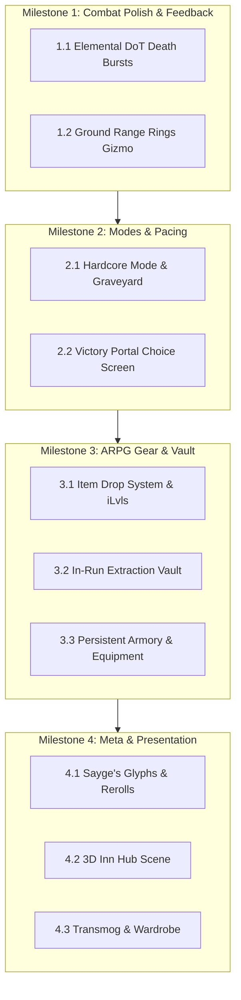

# Porting Plan: Bringing Hordes of Azeroth Features into Azeroth Survivors

> **Review status**: Corrections applied 2026-11-06 — all mechanics claims verified against live source.

## 1. Executive Summary

**Project Goal**: Transform [`azeroth-survivors-re`](file:///home/ubuntu/azeroth-survivors-re) from a single-run arcade survival prototype into a premier, highly replayable ARPG Roguelike by porting the proven, beloved systems from [`hordes-of-azeroth`](file:///home/ubuntu/hordes-of-azeroth) (HoA v0.6.4).

### Architectural Translation
* **Source (`hordes-of-azeroth`)**: World of Warcraft 1.12.1 client (`WoW.exe`) + custom C++ MaNGOS backend + Lua/XML AddOn (`Interface/AddOns/HordesOfAzeroth/`).
* **Target (`azeroth-survivors-re`)**: Standalone Rust 2021 + Bevy ECS engine (`benilla`), compiling to native Linux/Windows and WebAssembly (WebGPU) with zero server requirement.
* **Core Target Module**: [`crates/benilla-app/src/survivors/`](file:///home/ubuntu/azeroth-survivors-re/crates/benilla-app/src/survivors/).

---

## 2. Feature Gap & Porting Matrix

> [!NOTE]
> The **Elite Champion system** (`ChampionModifier::Molten/Frozen/Vampiric/Avenger/Shielded`) is **already fully implemented** in `enemies.rs`. It is not a porting gap.

| Feature | `hordes-of-azeroth` Source | `azeroth-survivors-re` Target | Impact & Priority |
| :--- | :--- | :--- | :--- |
| **Ailment Death Bursts** | `VanillaBonk.lua` (0.6.2/0.6.4) | [`abilities.rs`](file:///home/ubuntu/azeroth-survivors-re/crates/benilla-app/src/survivors/abilities.rs), [`enemies.rs`](file:///home/ubuntu/azeroth-survivors-re/crates/benilla-app/src/survivors/enemies.rs) | **P0 (Immediate)** - Massive combat satisfaction |
| **Spell Range Rings** | [`VanillaBonkRangeRing.lua`](file:///home/ubuntu/hordes-of-azeroth/Interface/AddOns/HordesOfAzeroth/VanillaBonkRangeRing.lua) | [`hero.rs`](file:///home/ubuntu/azeroth-survivors-re/crates/benilla-app/src/survivors/hero.rs), [`hud.rs`](file:///home/ubuntu/azeroth-survivors-re/crates/benilla-app/src/survivors/hud.rs) | **P0 (Immediate)** - Essential positioning QoL |
| **Hardcore Mode & Graveyard** | [`VanillaBonkHardcore.lua`](file:///home/ubuntu/hordes-of-azeroth/Interface/AddOns/HordesOfAzeroth/VanillaBonkHardcore.lua) | [`save.rs`](file:///home/ubuntu/azeroth-survivors-re/crates/benilla-app/src/survivors/save.rs), [`menu.rs`](file:///home/ubuntu/azeroth-survivors-re/crates/benilla-app/src/survivors/menu.rs), [`hud.rs`](file:///home/ubuntu/azeroth-survivors-re/crates/benilla-app/src/survivors/hud.rs) | **P1 (High)** - Adds emotional stakes & replayability |
| **Victory Portal Choice Screen** | [`VanillaBonkRunMaster.lua`](file:///home/ubuntu/hordes-of-azeroth/Interface/AddOns/HordesOfAzeroth/VanillaBonkRunMaster.lua) | [`mod.rs`](file:///home/ubuntu/azeroth-survivors-re/crates/benilla-app/src/survivors/mod.rs), [`hud.rs`](file:///home/ubuntu/azeroth-survivors-re/crates/benilla-app/src/survivors/hud.rs) | **P1 (High)** - Adds meaningful run conclusion |
| **Extraction Vault & Persistent Gear** | [`VanillaBonkVault.lua`](file:///home/ubuntu/hordes-of-azeroth/Interface/AddOns/HordesOfAzeroth/VanillaBonkVault.lua), [`VanillaBonkGear.lua`](file:///home/ubuntu/hordes-of-azeroth/Interface/AddOns/HordesOfAzeroth/VanillaBonkGear.lua) | `vault.rs` (new), `gear.rs` (new), [`save.rs`](file:///home/ubuntu/azeroth-survivors-re/crates/benilla-app/src/survivors/save.rs) | **P1 (High)** - Long-term ARPG progression loop |
| **Sayge's Glyphs & Deck Modifiers** | [`VanillaBonkGlyphs.lua`](file:///home/ubuntu/hordes-of-azeroth/Interface/AddOns/HordesOfAzeroth/VanillaBonkGlyphs.lua), [`VanillaBonkDeck.lua`](file:///home/ubuntu/hordes-of-azeroth/Interface/AddOns/HordesOfAzeroth/VanillaBonkDeck.lua) | `glyphs.rs` (new), [`cards.rs`](file:///home/ubuntu/azeroth-survivors-re/crates/benilla-app/src/survivors/cards.rs) | **P2 (Medium)** - Deep build customization |
| **3D Inn Town Hub & NPCs** | [`VanillaBonkInnkeeper.lua`](file:///home/ubuntu/hordes-of-azeroth/Interface/AddOns/HordesOfAzeroth/VanillaBonkInnkeeper.lua), [`VanillaBonkQuartermaster.lua`](file:///home/ubuntu/hordes-of-azeroth/Interface/AddOns/HordesOfAzeroth/VanillaBonkQuartermaster.lua) | `hub.rs` (new), [`mod.rs`](file:///home/ubuntu/azeroth-survivors-re/crates/benilla-app/src/survivors/mod.rs) | **P2 (Medium)** - World immersion & town prep |
| **Transmog & Wardrobe System** | [`VanillaBonkTransmog.lua`](file:///home/ubuntu/hordes-of-azeroth/Interface/AddOns/HordesOfAzeroth/VanillaBonkTransmog.lua) | `transmog.rs` (new), [`units.rs`](file:///home/ubuntu/azeroth-survivors-re/crates/benilla-app/src/survivors/units.rs) | **P3 (Cosmetic)** - Visual collection hobby |

---

## 3. Detailed Specification by Feature Pillar

### Pillar 1: Combat Feel & Juiciness

#### 1.1 Elemental Ailment Death Bursts
* **Source Concept**: When an enemy with active DoTs dies, all remaining dot damage bursts outward onto up to 4 targets within 8 yards.

> [!IMPORTANT]
> `azeroth-survivors-re` has **no Bleed/Burn/Poison type enum**. The [`Effect`](file:///home/ubuntu/azeroth-survivors-re/crates/benilla-app/src/survivors/data.rs#L61-L74) enum only has `Slow`, `Root`, `Stun`, `Fear`, `Weaken`, `Drain`, `Execute`. DoTs are untyped `Dot { spell, key, dps, left, tick }`. Ailment school must be inferred from `dot.key` or by adding an `AilmentKind` field to the `Dot` struct.

* **Required: `AilmentKind` tag on `Dot`**:
  ```rust
  pub enum AilmentKind { Bleed, Burn, Poison, Generic }

  pub struct Dot {
      pub spell: u32,
      pub key: &'static str,
      pub dps: f32,
      pub left: f32,
      pub tick: f32,
      pub ailment: AilmentKind,  // NEW
  }
  ```
  Mapping from existing DoT keys:
  | Key | Ailment |
  | :--- | :--- |
  | `"rupture"` | `Bleed` |
  | `"immolate"`, `"corruption"` | `Burn` |
  | `"serpent_sting"` | `Poison` |
  | `"moonfire"`, `"insect_swarm"`, `"curse_of_agony"` | `Generic` |

* **Mechanics**:
  * Remaining damage is calculated **before** `en.dots.clear()` fires. The burst hook must live inside the `kill` closure in `apply_hits` ([`abilities.rs:928-965`](file:///home/ubuntu/azeroth-survivors-re/crates/benilla-app/src/survivors/abilities.rs#L928-L965)), not in `drop_loot`:
    ```rust
    // Inside kill closure, BEFORE en.dots.clear():
    let burst_dmg: f32 = en.dots.iter()
        .filter(|d| !matches!(d.ailment, AilmentKind::Generic))
        .map(|d| d.dps * d.left)
        .sum();
    let burst_spell: u32 = /* pick visual per dominant ailment school */;
    en.dots.clear(); // existing line — burst window closes here
    ```
  * Query up to 4 living enemies within $8.0$ yards; split `burst_dmg` evenly between them.
  * Per-school visual: Fire impact (`spell 20481`) for Burn, Blood splatter (`spell 11579`) for Bleed, Nature burst (`spell 8092`) for Poison.

* **Cross-Ability Synergies** (using actual ability keys from [`data.rs`](file:///home/ubuntu/azeroth-survivors-re/crates/benilla-app/src/survivors/data.rs)):
  * **Rogue**: *`eviscerate`* damage scales $+5\%$ per active `Bleed` DoT tick remaining on the target (`rupture` key).
  * **Druid**: *`hurricane`* ground area deals $+8\%$ damage to targets currently under a `moonfire` or `insect_swarm` DoT.
  * **Warlock**: *`shadow_bolt`* scales with whichever of `corruption` (Burn) or `curse_of_agony` has more `dps × left` remaining on the target.
* **Target Files**:
  * Modify [`crates/benilla-app/src/survivors/enemies.rs`](file:///home/ubuntu/azeroth-survivors-re/crates/benilla-app/src/survivors/enemies.rs) — add `AilmentKind` to `Dot`.
  * Modify [`crates/benilla-app/src/survivors/abilities.rs`](file:///home/ubuntu/azeroth-survivors-re/crates/benilla-app/src/survivors/abilities.rs) — burst logic in `kill` closure before `dots.clear()`.
  * Propagate `ailment` tag through all `en.dots.push(...)` sites in `abilities.rs`.

#### 1.2 Tactical Range Rings
* **Source Reference**: [`VanillaBonkRangeRing.lua`](file:///home/ubuntu/hordes-of-azeroth/Interface/AddOns/HordesOfAzeroth/VanillaBonkRangeRing.lua)
* **Mechanics**:
  * Renders circular ring decals or torus meshes on the ground around the hero.
  * Displays dynamic ranges read from the hero's **currently owned `AbilityDef` list** — there are no single global range constants. `AbilityDef::range` is authoritative; `HERO_RADIUS = 0.7` is the body collision radius, not a melee range. Example per-ability actual values:
    * Melee abilities (`sinister_strike`, `cleave`): `range: 5.5` yd.
    * AoE ground (`hurricane`): `radius: 8.0` yd.
    * Long bolt (`aimed_shot`, `serpent_sting`): `range: 26.0–28.0` yd.
  * Displays:
    * **Inner circle**: smallest active melee `AbilityDef::range` (varies by class).
    * **AoE circles**: one ring per owned ability where `radius > 0`, drawn at `AbilityDef::radius`.
    * **Outer ring**: largest owned ability `AbilityDef::range`.
  * Configurable via HUD toggle (`R` or via settings): opacity ($0.2..0.8$), color matching class/spell school.
* **Target Files**:
  * Add Bevy ring gizmo/mesh system in [`crates/benilla-app/src/survivors/hero.rs`](file:///home/ubuntu/azeroth-survivors-re/crates/benilla-app/src/survivors/hero.rs), reading from `run.abilities` each frame.

---

### Pillar 2: High Stakes & Pacing

#### 2.1 Hardcore Mode & The Graveyard Memorial
* **Source Reference**: [`VanillaBonkHardcore.lua`](file:///home/ubuntu/hordes-of-azeroth/Interface/AddOns/HordesOfAzeroth/VanillaBonkHardcore.lua)
* **Mechanics**:
  * Character creation adds a **[x] Hardcore Mode** toggle.
  * Hardcore characters have an isolated save state (`hardcore_gold`, `hardcore_vault`).
  * **Death Handling**:
    * Triggers custom *"You Have Fallen"* screen showing:
      * Level reached, zone, duration survived.
      * Cause of death (killing creature/boss name and ability).
      * Total damage dealt and killing spree record.
    * Player options:
      1. **Lay to Rest**: Permanently locks character and writes entry to `AccountSave::graveyard`.
      2. **Keep Playing**: Converts character into a Standard (Softcore) character with retained level/gear.
  * **Graveyard UI**:
    * Accessible from the campfire menu. Lists all fallen legends with class icon, race, death date, level, and killer.
* **Data Structs**:
  ```rust
  #[derive(Debug, Clone, Serialize, Deserialize)]
  pub struct FallenHero {
      pub name: String,
      pub race: u8,
      pub class: u8,
      pub level: u32,
      pub zone: String,
      pub survived_secs: f32,
      pub killed_by: String,
      pub date_utc: String,
      pub highest_spree: u32,
  }
  ```
* **Target Files**:
  * Modify [`crates/benilla-app/src/survivors/save.rs`](file:///home/ubuntu/azeroth-survivors-re/crates/benilla-app/src/survivors/save.rs) — add `graveyard` and `is_hardcore` fields; use `#[serde(default)]` for forward-compatibility. Note: `AccountSave` persists to `survivors-account.toml` via `crate::local_state` on native and `localStorage` on wasm32 — both paths are handled by existing infrastructure.
  * Modify [`crates/benilla-app/src/survivors/hud.rs`](file:///home/ubuntu/azeroth-survivors-re/crates/benilla-app/src/survivors/hud.rs)
  * Modify [`crates/benilla-app/src/survivors/menu.rs`](file:///home/ubuntu/azeroth-survivors-re/crates/benilla-app/src/survivors/menu.rs)

#### 2.2 Victory Portal Choice Screen
* **Source Reference**: [`VanillaBonkRunMaster.lua`](file:///home/ubuntu/hordes-of-azeroth/Interface/AddOns/HordesOfAzeroth/VanillaBonkRunMaster.lua)

> [!NOTE]
> **Overtime already exists.** At `run.elapsed >= VICTORY_SECS` (900 s / 15 min), [`hero.rs:603-611`](file:///home/ubuntu/azeroth-survivors-re/crates/benilla-app/src/survivors/hero.rs#L603-L611) automatically sets `run.won = true; run.overtime = true;`. The game already supports endless overtime. What HoA adds is the **explicit choice screen** ("Finish the Run" vs "Continue in Endless Mode") that the player must actively decide at the moment of victory — giving them agency over risk/reward rather than auto-escalating.

* **Mechanics**:
  * Defeating the final boss (at or after `VICTORY_SECS`) or reaching the victory timer triggers `Phase::PortalChoice` instead of immediately flipping `run.overtime`.
  * A full-screen portal prompt appears:
    * **"Finish the Run"** → safely write high scores, award completion bonus gold (`+200g`), return to menu. `run.won = true`, `run.overtime` stays `false`.
    * **"Continue in Endless Mode"** → set `run.won = true; run.overtime = true;`, display the existing overtime banner, and continue. Monster health and move speed scale via `data::hp_scale` / `data::damage_scale` driven by `run.elapsed`, which already accelerates past `VICTORY_SECS` (see [`data.rs:1783-1790`](file:///home/ubuntu/azeroth-survivors-re/crates/benilla-app/src/survivors/data.rs#L1783-L1790)).
  * **Stage structure** (proposed default anchor points, subject to tuning):
    * Stage 1 ends at `run.bosses == 1` — defeat the first zone boss.
    * Stage 2 ends at `run.bosses == 3` — an Enchanter NPC spawns at the mid-run portal.
    * Stage 3 / Victory: `run.elapsed >= VICTORY_SECS` (900 s / 15 min). `run.bosses` and `run.rings` are the existing counters driving boss gates.
* **Target Files**:
  * Modify [`crates/benilla-app/src/survivors/mod.rs`](file:///home/ubuntu/azeroth-survivors-re/crates/benilla-app/src/survivors/mod.rs) — add `Phase::PortalChoice`.
  * Modify [`crates/benilla-app/src/survivors/hud.rs`](file:///home/ubuntu/azeroth-survivors-re/crates/benilla-app/src/survivors/hud.rs) — render choice UI on `Phase::PortalChoice`.
  * Modify [`crates/benilla-app/src/survivors/hero.rs`](file:///home/ubuntu/azeroth-survivors-re/crates/benilla-app/src/survivors/hero.rs) — gate the existing `run.won / run.overtime` flip behind `Phase::PortalChoice` instead of auto-firing.

---

### Pillar 3: The ARPG Loot & Extraction Loop

#### 3.1 Extraction Vault & Persistent Gear
* **Source Reference**: [`VanillaBonkVault.lua`](file:///home/ubuntu/hordes-of-azeroth/Interface/AddOns/HordesOfAzeroth/VanillaBonkVault.lua), [`VanillaBonkGear.lua`](file:///home/ubuntu/hordes-of-azeroth/Interface/AddOns/HordesOfAzeroth/VanillaBonkGear.lua)
* **Mechanics**:
  * **Equipment Slots**: Head, Shoulders, Chest, Legs, Main Hand, Off-Hand, Trinket 1, Trinket 2, Tabard.
  * **Loot Drops**:
    * Bosses and chests drop unidentified gear pieces with rarity tiers (Common $\rightarrow$ Uncommon $\rightarrow$ Rare $\rightarrow$ Epic $\rightarrow$ Legendary).
    * Primary stats: Stamina ($+10\text{ HP}$), Strength/Agility ($+\text{Physical Power}$), Intellect ($+\text{Spell Power}$), Haste ($\% \text{ Cooldown CDR}$), Crit ($\% \text{ Chance}$).
  * **Extraction Vault UI**:
    * Player has a limited Extraction Vault (starts at 2 slots, upgradeable to 4).
    * During the run, newly found gear must be moved into the Vault. Un-vaulted gear is lost on death!
    * If the run is successfully extracted (or completed), items in the Vault are transferred to the persistent **Account Armory / Bank**.
  * **Durgan Ironbelly (Vendor/Blacksmith)**:
    * In the Town Hub or Menu, players can equip items onto characters or salvage unwanted items for gold and Enchanting Dust.
* **Data Structs**:
  ```rust
  /// Stat types that appear on gear. Maps directly to hero modifiers in Run.
  #[derive(Debug, Clone, Copy, PartialEq, Eq, Hash, Serialize, Deserialize)]
  pub enum StatType {
      Stamina,     // +HP
      Strength,    // +Physical damage (Warrior, Rogue, Paladin, Druid)
      Agility,     // +Physical damage & crit (Hunter, Rogue)
      Intellect,   // +Spell power (Mage, Priest, Warlock, Shaman, Druid)
      Haste,       // -Cooldown %
      Crit,        // +Crit chance %
      Armor,       // -Damage taken %
  }

  #[derive(Debug, Clone, Serialize, Deserialize)]
  pub struct GearItem {
      pub id: u32,                        // Template base ID; procedural items use 0xFFFF_xxxx
      pub name: String,
      pub slot: EquipSlot,
      pub quality: ItemQuality,
      pub item_level: u32,
      pub stats: HashMap<StatType, f32>,
      pub display_id: u32,                // WoW model display ID for 3D preview
      pub icon_path: &'static str,        // BLP path, e.g. "Interface/Icons/INV_Weapon_Sword_01"
  }
  ```
* **New Files**:
  * Create `crates/benilla-app/src/survivors/gear.rs`
  * Create `crates/benilla-app/src/survivors/vault.rs`

---

### Pillar 4: Deep Customization & Hub Experience

#### 4.1 Sayge's Glyphs & Darkmoon Deck
* **Source Reference**: [`VanillaBonkGlyphs.lua`](file:///home/ubuntu/hordes-of-azeroth/Interface/AddOns/HordesOfAzeroth/VanillaBonkGlyphs.lua)
* **Mechanics**:
  * Major & Minor Glyphs collected during runs or purchased from Sayge with Darkmoon Tickets.
  * Example Glyphs (using actual ability keys from [`data.rs`](file:///home/ubuntu/azeroth-survivors-re/crates/benilla-app/src/survivors/data.rs)):
    * *Glyph of the Moving Blizzard*: `hurricane` ground area tracks the hero's position, $-15\%$ damage.
    * *Glyph of Piercing Shadow*: `shadow_bolt` pierces through all enemies in a line, $-20\%$ damage.
    * *Glyph of Consecration*: `consecration` area heals the hero for $1.0\%\text{ HP/s}$ while standing in it.
    * *Glyph of Rupture*: `rupture` DoT bursts deal $+50\%$ more damage on target death.
  * **Rewritten Fate (Extra Rerolls)**:
    * `run.rerolls: u32` already exists (default `2`) and is consumed via `KeyCode::KeyR` in [`cards.rs`](file:///home/ubuntu/azeroth-survivors-re/crates/benilla-app/src/survivors/cards.rs). Sayge's *Rewritten Fate* item simply awards `run.rerolls += 1` per rank — no new HUD infrastructure needed.
* **New Files**:
  * Create `crates/benilla-app/src/survivors/glyphs.rs`

#### 4.2 3D Town Hub (The Inn)
* **Source Reference**: [`VanillaBonkInnkeeper.lua`](file:///home/ubuntu/hordes-of-azeroth/Interface/AddOns/HordesOfAzeroth/VanillaBonkInnkeeper.lua)
* **Mechanics**:
  * Instead of booting straight into the 2D zone select, the default state is `Phase::Hub`.
  * Renders an indoor tavern instance (e.g., Lion's Pride Inn WMO for Alliance, Bloodhoof Inn WMO for Horde).
  * Interactive 3D NPCs:
    * **Innkeeper**: Talent tree meta-upgrades, rest bonus.
    * **Quartermaster Durgan**: Gear vendor, upgrades, salvaging.
    * **Sayge <Darkmoon Faire>**: Glyphs and fortune buffs.
    * **Run Master**: Stage, difficulty (Normal, Heroic, Mythic+), and zone selection.
    * **Target Dummies**: Stationary damage test dummies to test DPS meter and DPS synergies.
* **New Files**:
  * Create `crates/benilla-app/src/survivors/hub.rs`

#### 4.3 Transmogrification (Wardrobe) & Tabards
* **Source Reference**: [`VanillaBonkTransmog.lua`](file:///home/ubuntu/hordes-of-azeroth/Interface/AddOns/HordesOfAzeroth/VanillaBonkTransmog.lua)
* **Mechanics**:
  * Equipping, looting, or salvaging an item records its `display_id` into `AccountSave::transmog_unlocked`.
  * Dressing Room interface:
    * Preview character 3D model with 360° rotation.
    * Toggle "Hide Helm", "Hide Shoulders", "Hide Cloak".
    * Select cosmetic Tabards (Scarlet Crusade, Argent Dawn, Darkmoon, Frost, Flame).
* **New Files**:
  * Create `crates/benilla-app/src/survivors/transmog.rs`

---

## 4. Phased Implementation Roadmap



### Phase 1: Immediate Combat Polish (Estimated: 3-4 days)
1. Add `AilmentKind` field to `Dot` struct in [`enemies.rs`](file:///home/ubuntu/azeroth-survivors-re/crates/benilla-app/src/survivors/enemies.rs) and tag all `en.dots.push(...)` sites with the correct ailment school.
2. Implement DoT burst logic **inside the `kill` closure** in [`abilities.rs`](file:///home/ubuntu/azeroth-survivors-re/crates/benilla-app/src/survivors/abilities.rs), before `en.dots.clear()`, sampling remaining damage and distributing it to up to 4 nearby enemies.
3. Add cross-DoT synergies using actual ability keys: Rogue `eviscerate` + `rupture` stacks, Druid `hurricane` + `moonfire`/`insect_swarm`, Warlock `shadow_bolt` + `corruption`/`curse_of_agony`.
4. Implement dynamic ground range ring gizmos in [`hero.rs`](file:///home/ubuntu/azeroth-survivors-re/crates/benilla-app/src/survivors/hero.rs), reading `AbilityDef::range` and `AbilityDef::radius` from `run.abilities` each frame.

### Phase 2: Stakes & Pacing Structure (Estimated: 2-3 days)
1. Add `is_hardcore` flag to character creation in [`menu.rs`](file:///home/ubuntu/azeroth-survivors-re/crates/benilla-app/src/survivors/menu.rs).
2. Build the *"You Have Fallen"* screen with "Lay to Rest" and "Keep Playing" actions.
3. Add `graveyard: Vec<FallenHero>` to [`save.rs`](file:///home/ubuntu/azeroth-survivors-re/crates/benilla-app/src/survivors/save.rs) and the Graveyard Hall UI in [`menu.rs`](file:///home/ubuntu/azeroth-survivors-re/crates/benilla-app/src/survivors/menu.rs).
4. Add `Phase::PortalChoice` to [`mod.rs`](file:///home/ubuntu/azeroth-survivors-re/crates/benilla-app/src/survivors/mod.rs). Gate the existing `run.won / run.overtime` flip in [`hero.rs`](file:///home/ubuntu/azeroth-survivors-re/crates/benilla-app/src/survivors/hero.rs) behind a "Finish Run" vs "Continue in Endless Mode" choice UI in [`hud.rs`](file:///home/ubuntu/azeroth-survivors-re/crates/benilla-app/src/survivors/hud.rs).

### Phase 3: The ARPG Loot & Extraction Loop (Estimated: 3-4 days)
1. Define `StatType` enum, `GearItem`, `EquipSlot`, `ItemQuality`, and procedural item generation tables in `gear.rs`.
2. Implement the `ExtractionVault` component and in-run HUD overlay in `vault.rs`.
3. Save extracted items to `AccountSave::inventory` in [`save.rs`](file:///home/ubuntu/azeroth-survivors-re/crates/benilla-app/src/survivors/save.rs).
4. Build the Character Armory UI to equip/unequip gear and apply `StatType` values to the hero's `Run` state.

### Phase 4: Build Depth & Immersion (Estimated: 3-5 days)
1. Create `glyphs.rs` with ability-key-aware spell modifiers. For *Rewritten Fate* rerolls: `run.rerolls` already exists and is consumed on `KeyCode::KeyR` — Sayge simply awards `run.rerolls += n` per purchased rank, requiring no new HUD.
2. Build `hub.rs` to load the 3D Inn instance, spawn NPCs (Innkeeper, Quartermaster, Sayge, Run Master, Target Dummies), and transition into `Phase::Hub`.
3. Create `transmog.rs` to unlock and apply weapon/armor display IDs to `UnitSpec`.

---

## 5. Verification & Testing Strategy

1. **Deterministic Save File Upgrades**:
   * Ensure any schema additions to `AccountSave` (`survivors-account.toml`) use `#[serde(default)]` so existing player saves load without corruption.
2. **WASM / WebGPU Performance**:
   * Range rings and 3D hub rendering must maintain 60 FPS in browser WebGPU builds without memory leaks or excessive draw calls.
3. **Gameplay Balance Checks**:
   * Verify DoT bursts do not cause infinite recursion loops on swarm deaths.
   * Verify Endless Mode scaling dynamically outpaces player healing to prevent infinite stalls.
